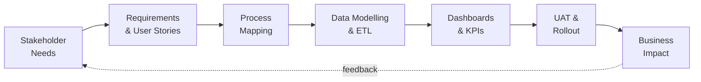

<!-- ===================== HEADER ===================== -->
<p align="center">
  
</p>

<p align="center">
  <a href="https://github.com/Mohammedimad01">
    
  </a>
</p>

<p align="center">
  
  
  
</p>

---

## About Me


I'm a **Business Technology Analyst** who sits where **business, data and technology** meet. I translate stakeholder needs into clear requirements, turn raw data into decisions, and ship the tools that make it happen.

- **Technical Lead, Software Developer** at **Qlovix**
- **Founder** of **SkillBridge AI**, an AI employability platform (Aspire pre-seed fund)
- **1st Place**, Product Innovation Challenge (EcoFlow)
- Focus areas: Business Analysis, BI & Reporting, Process Improvement, Generative AI for business
- Ask me about **requirements gathering, KPI design, dashboards, SQL and AI automation**
- Fun fact: I enjoy turning messy data and messy processes into clean, visual stories

<br clear="right" />

```yaml
name: Mohammed Imad
role: Business Technology Analyst
looking_for: [Business Technology Analyst, IT Business Analyst, BI Analyst, Analytics Consultant, Data Analyst]
superpowers:
  - Requirements, User Stories and UAT
  - Data Modelling, ETL and KPI Development
  - Dashboards that executives actually use
  - AI / LLM-powered workflow automation
motto: "Understand the business. Let the data speak. Build what matters."
```

---

## Experience

| Role | Organisation | Since |
|:--|:--|:--|
| **Technical Lead, Software Developer** | Qlovix (Hybrid) | Sep 2025 |
| **Data Analyst Intern** | Meknoid Solutions Pvt. Ltd. | Jul 2025 |
| **Business Operations & Project Management Intern** | Rainbow Pipes | Apr 2025 |

---

## Skills & Toolkit

<details open>
<summary><b>Business Analysis</b></summary>
<br>


</details>

<details open>
<summary><b>Data & Analytics</b></summary>
<br>


</details>

<details open>
<summary><b>BI & Reporting</b></summary>
<br>

-F2C811?style=for-the-badge&logo=powerbi&logoColor=black)


</details>

<details open>
<summary><b>AI & Technology</b></summary>
<br>


</details>

<p align="center">
  
</p>

---

## Certifications & Achievements

<p align="center">
  
  
  
  <br/>
  
  
  
</p>

---

## How I Work



---

## GitHub Analytics

<p align="center">
  
</p>

<p align="center">
  
  
</p>

<p align="center">
  
  
</p>

### Contribution Snake

<p align="center">
  <picture>
    <source media="(prefers-color-scheme: dark)" srcset="https://raw.githubusercontent.com/Mohammedimad01/Mohammedimad01/output/github-snake-dark.svg" />
    <source media="(prefers-color-scheme: light)" srcset="https://raw.githubusercontent.com/Mohammedimad01/Mohammedimad01/output/github-snake.svg" />
    
  </picture>
</p>

---

## Let's Connect

<p align="center">
  I'm actively exploring <b>Business Technology Analyst</b>, <b>IT Business Analyst</b>, <b>BI Analyst</b> and <b>Analytics Consultant</b> opportunities.<br/>
  If your team needs someone who can speak both <i>business</i> and <i>tech</i>, let's talk!
</p>

<p align="center">
  <a href="https://github.com/Mohammedimad01"></a>
</p>

<p align="center">
  
</p>

<!-- ===================== FOOTER ===================== -->
<p align="center">
  
</p>
